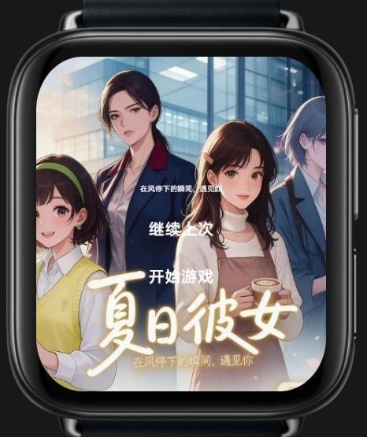
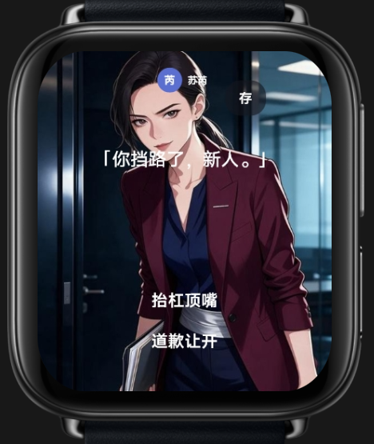
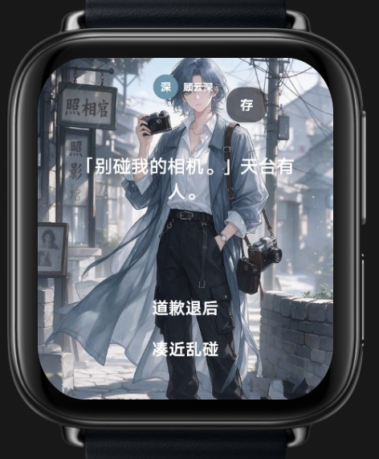

# 夏日彼女

> 在风停下的瞬间，遇见你。

《夏日彼女》是一款面向智能手表的互动剧情游戏。故事围绕夏日里的职场邂逅、角色交流与咖啡馆日常展开；阅读角色对白，并在关键时刻选择回应，体验一段轻松的相遇故事。

## 怎么玩

1. 从首页选择继续上次进度或开始游戏。
2. 阅读角色对话，留意当前场景与人物。
3. 在剧情选项中选择回应，例如礼貌道歉、直接表达态度等，继续推进对话。

## 游戏画面

| 首页 | 办公室相遇 |
| --- | --- |
|  |  |

| 摄影师场景 | 咖啡馆日常 |
| --- | --- |
|  |  |

## 下载

- [下载 RPK 安装包](downloads/com.yangcheng.xindonghour-1.0.0-debug.rpk)

## 安装包信息

- 包名：`com.yangcheng.xindonghour`
- 版本：`1.0.0`（versionCode `1`）
- 设备类型：圆形表盘、方形表盘
- 构建类型：Debug

这是提供的 RPK 安装包，不包含游戏源代码。安装需要兼容 RPK 的手表运行环境。
